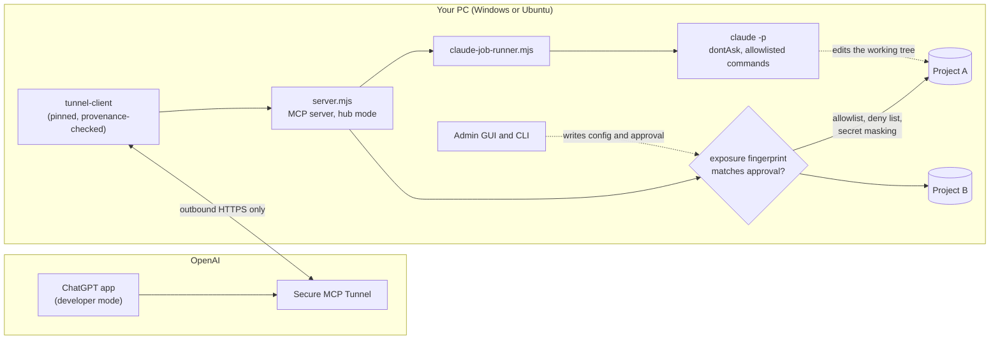

# ChatGPT Project Bridge

[](https://github.com/ringo7pie/chatgpt-project-bridge/actions/workflows/ci.yml)
[](https://github.com/ringo7pie/chatgpt-project-bridge/releases)
[](LICENSE)


**Give ChatGPT a live, read-only view of the projects on your own PC, and let it hand approved coding jobs to Claude Code, without uploading your workspace or opening a single inbound port.**

ChatGPT Project Bridge is a local [Model Context Protocol](https://modelcontextprotocol.io/) server for ChatGPT, connected through OpenAI's Secure MCP Tunnel.
ChatGPT pulls only what you have approved (selected documents, Git status, and, if you opt in, source code) and never gets a shell.
Each project's exposure is shown to you as a SHA-256 fingerprint, and until you approve that exact fingerprint on your PC, every tool refuses to answer.

> 日本語の詳しい手引きは [README.ja.md](README.ja.md) にあります（導入・設定・全ツールの引数と返却例・変更履歴）。

| | |
|---|---|
| **Portfolio page** | [docs/portfolio.md](docs/portfolio.md): the problem, design decisions, and numbers |
| **Security model** | [SECURITY.md](SECURITY.md): what the bridge guarantees and what it does not |
| **Install** | [Releases](https://github.com/ringo7pie/chatgpt-project-bridge/releases) (one-command installers for Windows and Ubuntu) |
| **Manual (Japanese)** | [README.ja.md](README.ja.md), [references/setup.md](references/setup.md), [illustrated install guide](references/インストールマニュアル.html) |
| **Changelog** | [references/CHANGELOG-2.4.0.md](references/CHANGELOG-2.4.0.md) (2.4.0 to 2.10.1, with the verification results of each release) |

## Why

Talking to ChatGPT about a local project usually means pasting files into the chat.
The pasted context goes stale, it leaks more than you meant to share, and ChatGPT cannot check its own advice against the code.
This bridge turns that around: ChatGPT asks for exactly what it needs, through narrow tools, at the moment it needs it, and the PC decides what it may see.

## Highlights

- **Approve-by-fingerprint.** The exposure of each project (allowed files and folders, deny list, Git and source opt-ins, Claude Code settings) is normalized and hashed. The approval lives outside the project, so editing `.chatgpt-project-bridge.json` silently changes nothing: the server stops answering until you approve the new fingerprint.
- **Read-only by default, 31 tools.** Documents, Git branches and diffs, project overview and tasks, code search, and test logs. Branch names, diff excerpts, and source text are separate opt-ins.
- **Hub mode.** One PC, one tunnel, one ChatGPT app, many projects. Each project keeps its own allowlist and its own approval.
- **Claude Code jobs (opt-in per project).** ChatGPT can start `claude -p` in an approved project. It edits the working tree and runs only the commands you allowlisted. Git write commands, shells, and network tools are rejected, and commit and push stay with you. ChatGPT can pick the model and effort per job (2.10.0).
- **Plan, implement, verify.** ChatGPT checks what Claude Code may do, writes a plan, shows it to you, starts the job, then reviews the result with `get_git_diff` and `read_source`, and sends a follow-up job if the diff does not match the plan.
- **Defense in depth.** Secret masking on every line, sensitive file names always refused, no links followed, `.git/config` keys that can run programs detected before any Git command, and on Windows, Git is started only by an absolute path, so a `git.exe` planted in a project is never run.
- **Admin GUI on both OSes.** Windows Forms (PowerShell 7) and GTK 3 (Python), sharing one config transformer in Node.js. Switch "source reading" and "Claude Code" per project with one click, where setting and approval are a single step.
- **Pinned, verified installs.** The installers download only the Tunnel Client and Node.js versions pinned in [`dependencies.lock.json`](dependencies.lock.json) and check their SHA-256. A Tunnel Client release is pinned only after `gh attestation verify` accepts its SLSA provenance.
- **Zero npm dependencies.** The server uses Node.js built-ins only. About 26,000 lines of product code come with about 14,500 lines of self-tests (about 1,250 checks on Windows, more on Linux).

## Architecture



- The Tunnel Client keeps an outbound connection to OpenAI, so no router port is opened and the MCP server is never exposed to the internet.
- The MCP server re-reads the hub file on every call and checks the project's approval before any file is opened.
- Claude Code runs as a separate process with a generated settings file whose deny rules mirror the bridge's never-read set. It inherits only an allowlisted environment (never the tunnel key or `ANTHROPIC_API_KEY`).

## Tools

| Group | Tools | Since |
|---|---|---|
| Documents and status | `list_projects`, `get_project_context`, `get_project_status`, `get_recent_changes`, `get_project_issues`, `list_documents`, `get_document`, `search`, `fetch` | 2.2 |
| Git and analysis | `get_git_branches`, `get_branch_details`, `compare_branches`, `get_worktree_details`, `get_recent_activity`, `get_project_overview`, `get_project_structure`, `get_project_tasks`, `get_project_validation`, `get_portfolio_summary` | 2.5.0 |
| Source reading | `list_source_files`, `search_code`, `read_source`, `find_references`, `get_git_diff`, `read_test_log` | 2.6.0 |
| Claude Code jobs | `get_claude_code_settings`, `start_claude_job`, `get_claude_job`, `read_claude_job_log`, `cancel_claude_job`, `list_claude_jobs` | 2.7.0, 2.9.0 |

The tools added in 2.5.0 and later separate `facts` from `inferences`, carry their sources and collection time, and page large results with a cursor.
Arguments, examples, and error codes for every tool are in [README.ja.md](README.ja.md).

## Security model in one minute

| ChatGPT can | ChatGPT cannot |
|---|---|
| Read files inside the approved allowlist | Read `.git`, `.env*`, keys, credentials, or anything in `denyDirectories` |
| See Git status, and branch names or diffs if you opted in | Run Git write commands, builds, or tests through the read tools |
| Search and read source if `sourceText` is on | Follow a symbolic link, junction, or hardlink out of the project |
| Start Claude Code in a project where you enabled `claudeCode` | Change any configuration or approval, or commit and push |

Text read from source, documents, and logs is treated as data, never as instructions.
The full list of guarantees, the residual risks (an allowlisted command that runs a project script lets Claude Code run arbitrary code through that script), and how to report a vulnerability are in [SECURITY.md](SECURITY.md).

## Quick start

1. Download the bundle for your OS from [Releases](https://github.com/ringo7pie/chatgpt-project-bridge/releases) and verify it against `SHA256SUMS.txt` (the steps are in [references/setup.md](references/setup.md)).
2. Run the installer from the extracted folder. It installs only user-local files and never creates projects, keys, tunnels, approvals, or startup jobs.

   ```powershell
   # Windows 10/11 x64
   powershell.exe -NoProfile -ExecutionPolicy Bypass -File .\install.ps1
   ```

   ```bash
   # Ubuntu 22.04 / 24.04 / 26.04 (amd64 or arm64)
   bash ./install.sh
   ```

3. Create a tunnel in the OpenAI Platform tunnel settings, then add your projects. The command shows the exposure and its fingerprint, and asks you to approve it.

   ```text
   chatgpt-hub-add
   ```

4. In ChatGPT, create a developer-mode app with Connection = Tunnel, and start a new chat: "List my projects and summarize the status of each."

The admin GUI (`chatgpt-project-bridge-gui`) covers the same steps with buttons.

## Tests

No build step. Every suite is a plain Node.js or Python script that creates its fixtures in a temporary folder, and CI runs them on Ubuntu (Node.js 20 and 24) and Windows (Node.js 24).

| Suite | What it checks | Checks (2.10.0; Windows unless noted) |
|---|---|---|
| `security-selftest.mjs` | Allowlist, sensitive names, masking, approval tampering, hub isolation, `.git/config` safety | 127 |
| `server-boundary-selftest.mjs` | Links, junctions, FIFOs, scan limits | 13 |
| `tools-selftest.mjs`, `git-tools-selftest.mjs`, `analysis-selftest.mjs` | The 2.5.0 Git and analysis tools, Git edge cases (worktrees, submodules, shallow clones) | 171, 161, 147 |
| `source-tools-selftest.mjs` | Source search and reading, secret files, log reading, read-only guarantee | 215 |
| `claude-jobs-selftest.mjs` | Claude Code jobs with a fake `claude`: arguments, settings, environment, limits, model and effort | 297 |
| `permission-cli-selftest.mjs` | The real Windows and Ubuntu CLIs switching permissions in a temporary profile | 58 |
| `snapshot-*-selftest.mjs` | Save-on-exit snapshots, signing, the HTTPS relay | 15, 13, 31 (relay: Linux) |
| `gui-selftest-windows-static.py`, `gui-selftest.py`, `workflow-selftest.py` | GUI logic (static on any OS, headless GTK on Linux), end-to-end add-project workflow (Linux) | 25, 43 (Linux), Linux only |

```bash
node scripts/security-selftest.mjs
node scripts/claude-jobs-selftest.mjs
python3 scripts/gui-selftest-windows-static.py
```

## Repository layout

| Path | Contents |
|---|---|
| `scripts/server.mjs` | The MCP server (single-project and hub mode), exposure checks, masking |
| `scripts/bridge-*.mjs` | Tool groups: Git, analysis, source reading, Claude Code jobs, permission switching |
| `scripts/claude-job-runner.mjs` | Starts and supervises `claude -p` for one job |
| `scripts/project-bridge.{ps1,py,sh}`, `project-bridge-gui.*` | Admin CLI and GUI for Windows (PowerShell 7) and Ubuntu (Python, GTK 3) |
| `scripts/install-windows.ps1`, `install-ubuntu.sh` | Installers, run from inside a bundle |
| `scripts/offline-bridge.mjs`, `snapshot-*.mjs` | Save-on-exit snapshots and the relay for reading them while the PC is off |
| `distribution.json`, `SHA256SUMS.txt`, `dependencies.lock.json` | What goes into a bundle, its hashes, and the pinned downloads |
| `references/`, `assets/` | Manuals, changelog, templates, GUI help text |

## How it was built

2.4.0 was produced by ChatGPT. From 2.4.1 on, each release was planned and reviewed by the author, implemented with Claude Code, and verified by the self-tests and by real end-to-end runs against a Windows hub and an Ubuntu hub.
Every release records what was checked before the change, the design decisions, and the verification results in [the changelog](references/CHANGELOG-2.4.0.md).
The same plan-then-implement loop is what the Claude Code job tools now offer from ChatGPT.

## Limitations

- The bridge has been run on Windows 11 and Ubuntu 24.04. macOS is not supported.
- Secret masking is a last line of defense, not a reason to allow sensitive documents.
- The server handles one request at a time, so a heavy search delays other calls (time limit 10 seconds by default, 30 at most).
- Claude Code jobs consume your Claude Code usage. Higher models and efforts consume more.

## License

[MIT](LICENSE).

## Trademarks and disclaimer

This is an independent, unofficial project. It is not affiliated with, endorsed by, or sponsored by OpenAI or Anthropic.
ChatGPT and OpenAI are trademarks of OpenAI. Claude and Claude Code are trademarks of Anthropic, PBC.
These names are used only to describe what the software connects to. No logos of either company are used in this repository.
